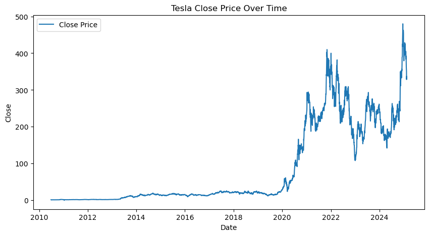
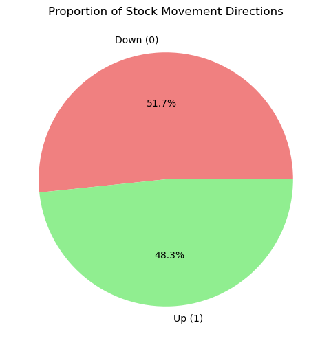
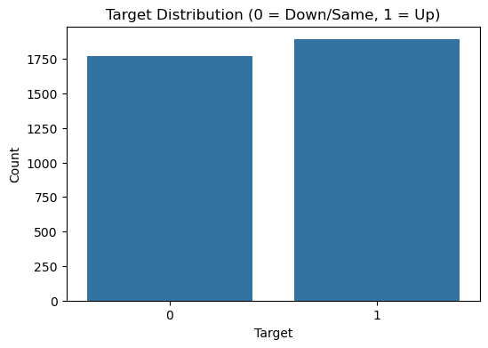
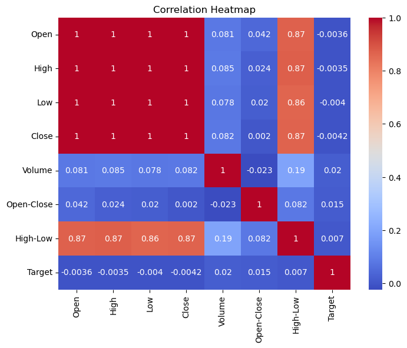
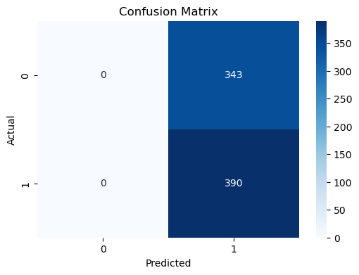
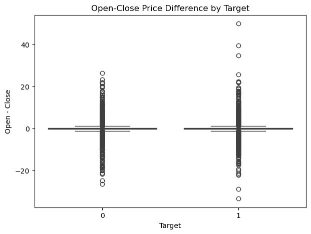

# Stock Price Trend Prediction (TSLA)

An internship machine learning project that analyzes ~15 years of historical **Tesla Inc. (TSLA)** daily stock market data (2010–2025) and predicts whether the next day's closing price will move **Up (`1`)** or **Down/Same (`0`)**.

This repository contains the project Jupyter Notebook (`STOCK_PRICE_TREND_PREDICTION__code.ipynb`), the historical dataset (`TSLA dataset.csv`), the project presentation (`Stock_Price_Trend_Prediction.pptx`), and extracted exploratory/evaluation visualizations.


## Repository Structure

```text
Stock-Price-Trend-Prediction/
├── STOCK_PRICE_TREND_PREDICTION__code.ipynb   # Main Jupyter Notebook (EDA, preprocessing, modeling, plots)
├── TSLA dataset.csv                           # Historical Tesla (TSLA) daily OHLCV dataset
├── Stock_Price_Trend_Prediction.pptx          # Project presentation slides
├── assets/                                    # Visualizations generated from the notebook
├── requirements.txt                           # Python dependencies
├── .gitignore
└── README.md
```

---

## Project Overview

Stock markets are highly volatile and influenced by numerous market factors. The goal of this project is to formulate short-term stock movement forecasting as a **binary classification** problem using historical OHLCV (Open, High, Low, Close, Volume) data:

- **Target = `1`**: Next day's closing price is higher than today's closing price (`Close[t+1] > Close[t]`)
- **Target = `0`**: Next day's closing price is lower than or equal to today's closing price

---

## Dataset Description

- **Company**: Tesla Inc. (`TSLA`)
- **Repository Dataset (`TSLA dataset.csv`)**: `3,162` daily trading records spanning **June 29, 2010 – January 19, 2023**.
- **Saved Notebook Output & Presentation Scope**: The saved outputs in the notebook and slides (`Stock_Price_Trend_Prediction.pptx`) reflect an extended `3,680`-row version of the dataset spanning **June 29, 2010 – February 13, 2025** *(referenced as `TSLA_2010-06-29_2025-02-13.csv` in the presentation)*.

| Column | Description |
| :--- | :--- |
| `Date` | Trading date |
| `Open` | Price at market open |
| `High` | Highest price of the day |
| `Low` | Lowest price of the day |
| `Close` | Price at market close |
| `Adj Close` | Adjusted close for dividends/splits *(dropped during cleaning)* |
| `Volume` | Total shares traded on that day |

---

## Methodology & Workflow

### 1. Exploratory Data Analysis & Data Cleaning
- Inspected dataset shape (`3680 x 7`), data types, summary statistics, unique counts, duplicate rows (`0`), and missing values (`Open`: 3, `High`: 5, `Low`: 6, `Close`: 6, `Adj Close`: 5).
- Parsed `Date` to `datetime` format.
- Imputed missing `Volume` values with the column median.
- Dropped the `Adj Close` column and removed remaining rows with null values (`3,661` clean records retained).

### 2. Feature Engineering
Derived two intraday price-action features alongside the five base market attributes:
- `Open-Close = Open - Close` — intraday directional spread
- `High-Low = High - Low` — daily trading range / volatility proxy
- `Target = (Close.shift(-1) > Close).astype(int)` — next-day trend label

**Feature Set (`X`)**: `['Open', 'High', 'Low', 'Close', 'Volume', 'Open-Close', 'High-Low']`

### 3. Model Building & Evaluation
- **Train-Test Split**: 80% training / 20% testing (`test_size=0.2`, `random_state=42`), yielding `733` test samples (`343` Down/Same, `390` Up).
- **Implemented Model**: `LogisticRegression(max_iter=1000)` from `scikit-learn`. *(The project presentation also outlines `RandomForestClassifier` as an ensemble comparison model.)*
- **Evaluation Metrics**: Accuracy score, confusion matrix, and precision/recall/F1 classification report.

---

## Results & Visualizations

### Observed Notebook Output (`LogisticRegression`)
- **Test Accuracy**: `53.21%` (`0.53206`) on `733` test samples *(Note: the presentation conclusion cites a 56–60% benchmark range across experiments)*.
- **Confusion Matrix**:
  ```text
  [[  0 343]
   [  0 390]]
  ```
- **Observation**: Because `Volume` is on a much larger numerical scale (`~10^7–10^8`) than price features without feature scaling (`StandardScaler`), the unscaled logistic model predicts the majority class (`1`) across the test set (recall `1.00` for class `1`, `0.00` for class `0`). Furthermore, the correlation heatmap confirms near-zero linear correlation (`-0.0042` to `0.02`) between raw daily OHLCV values and next-day direction.

### Key Visualizations

| Tesla Close Price Over Time (2010–2025) | Proportion of Stock Movement Directions |
| :---: | :---: |
|  |  |

| Target Class Distribution | Feature Correlation Heatmap |
| :---: | :---: |
|  |  |

| Confusion Matrix | Open-Close Price Difference by Target |
| :---: | :---: |
|  |  |

---

## System Requirements

### Hardware
- **Processor**: Intel Core i3 / AMD Ryzen 3 or better
- **RAM**: Minimum 4 GB (8 GB recommended)
- **Storage**: 500 MB free disk space
- **OS**: Windows 10 / macOS / Linux

### Software
- **Python**: 3.7 or later
- **IDE / Editor**: Jupyter Notebook or VS Code
- **Libraries**: `pandas >= 1.3`, `numpy >= 1.21`, `scikit-learn >= 0.24`, `matplotlib >= 3.4`, `seaborn`

---

## Getting Started

1. **Clone the repository**
   ```bash
   git clone https://github.com/Janardhan-Jillela/Stock-Price-Trend-Prediction..git
   cd Stock-Price-Trend-Prediction.
   ```

2. **Install dependencies**
   ```bash
   pip install -r requirements.txt
   ```

3. **Run the notebook**
   (`TSLA dataset.csv` is already included in the project root directory.)
   ```bash
   jupyter notebook STOCK_PRICE_TREND_PREDICTION__code.ipynb
   ```

---

## Future Improvements

- Apply feature scaling (`StandardScaler`) before training linear models such as `LogisticRegression`.
- Use chronological time-series splitting (`TimeSeriesSplit` or date cutoff) instead of random shuffling to prevent temporal look-ahead leakage.
- Add technical indicators (Moving Averages, RSI, MACD, lagged returns) and evaluate non-linear / tree-based models (`RandomForestClassifier`, `XGBoost`) as outlined in the presentation.
